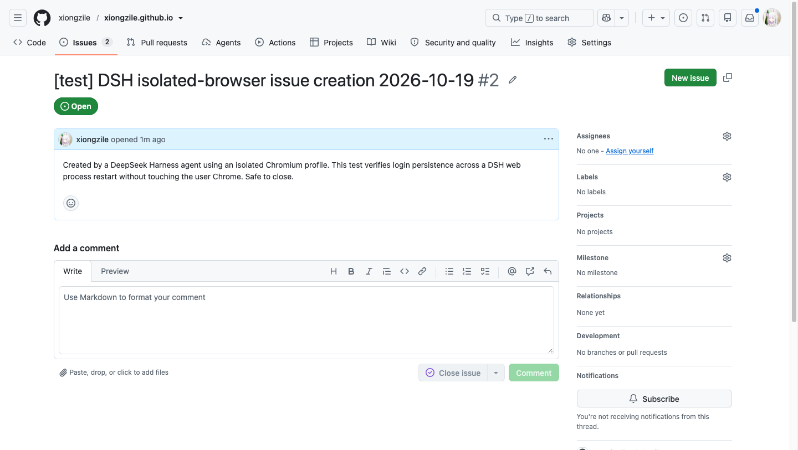

# 网页端登录态跨进程复用验收

> **历史记录（架构重构前）**：本文使用的 `task_*` 工具已全部删除。最终实现由 DSH Session/turn、tool trace、workspace changes、Goal 与 session repair 负责；本插件的结论仅保留浏览器/IDE/登录持久化部分的证据。见 [ARCHITECTURE-REVIEW.md](ARCHITECTURE-REVIEW.md)。


> 目标：在隔离 Chromium profile 中登录 GitHub 一次，正常关闭浏览器并重启源码 DSH web 进程，验证同一 profile 仍能免登录访问并创建 issue。
> 结果：**PASS**。测试 Issue：<https://github.com/xiongzile/xiongzile.github.io/issues/2>（已在测试后删除，见 [github-issue-deletion.txt](evidence/github-issue-deletion.txt)）。

## 1. 测试方法

源码 Web 使用独立 `DSH_HOME=.dsh-web`、profile `lovable-web` 和我们的插件 overlay；浏览器 profile 为 `github-issue-test`，全程不使用用户 Chrome 的 profile/cookies/window。

分两阶段：

### 第一阶段：登录一次

1. `task_start`（新任务 `task-2026-10-18T18-21-38-587Z-29551d`）
2. `background_browser_open(profile="github-issue-test", url="https://github.com/settings/profile")`
3. 未登录 → `background_browser_handoff` 打开独立可见窗口
4. 用户在该窗口登录 GitHub（`xiongzile`）
5. `background_browser_eval` 确认 `/settings/profile` 不再跳 `/login`，`meta[name=user-login] = xiongzile`
6. `background_browser_close(reset=false)` 正常关闭，cookie 落盘
7. `task_update(phase="awaiting_web_restart")`，停止

证据：`isolated_gui` — `Authenticated GitHub session established in the isolated profile...`

### 第二阶段：重启后复用

1. 正常结束源码 Web 进程，用**相同**命令 / `DSH_HOME` / overlay / profile 重启
2. 重启时插件自动把未完成任务标为 `recovering`
3. 新会话调用 `task_recover`（无参数）找到任务，确认无重复 issue 后 `action=resume`
4. `background_browser_open(profile="github-issue-test", url="https://github.com/settings/profile")` —— **没有调用 handoff，没有重新登录**
5. `background_browser_eval`：

```json
{
  "href": "https://github.com/settings/profile",
  "loginMeta": "xiongzile",
  "signInAppears": false,
  "signInLinks": []
}
```

6. 从该会话打开仓库 Issues，用 GitHub 网页表单创建 issue
7. 读取 issue URL、截图、`task_evidence(runtime_check)`、`task_finish(completed)`
8. `background_browser_close(reset=false)` 保留登录态

## 2. 结果

| 项 | 结果 |
|---|---|
| 登录一次 | ✅ 独立窗口完成 |
| 浏览器正常关闭 | ✅ `Browser.close`，cookie 落盘 |
| Web 进程重启 | ✅ 同一 `DSH_HOME`/`stateDir`/profile |
| 重启后免登录 | ✅ `/settings/profile` 直接打开，`user-login=xiongzile`，无 `Sign in` |
| 真实操作 | ✅ 创建 issue #2（测试后已删除） |
| 任务恢复 | ✅ 自动 `recovering` → `task_recover` 无参数 → `resume` |
| 用户 Chrome | ✅ 未使用（用户 Chrome PID `53671` 未被调用） |
| profile 保留 | ✅ close with `reset=false` |

Issue 证据：



- 标题：`[test] DSH isolated-browser issue creation 2026-10-19`
- URL：<https://github.com/xiongzile/xiongzile.github.io/issues/2>
- 状态：测试时 Open；现已删除（GitHub API 410）
- 页面显示 `xiongzile opened 1m ago`，证明是登录后的真实会话创建

结构化结果：[evidence/github-persistence-result.json](evidence/github-persistence-result.json)
完整任务记录：[evidence/github-persistence-task.json](evidence/github-persistence-task.json)

## 3. 这证明了什么

- **登录态绑定的是 profile 目录，不是网页端进程。**
- 正常关闭浏览器后，cookie 会落盘；重启 web 进程不会清空 profile。
- 我们的 `task_*` 恢复语义真实可用：重启后旧任务被标 `recovering`，新会话用 `task_recover`（无参数，已修复 lossless JSON bug）恢复并继续。
- 没有读取、复制或操作你的 Chrome；用的是独立 profile。

## 4. 边界

- 只验证了**正常关闭/正常重启**；`kill -9`、断电、宿主崩溃可能丢失最近未落盘的 cookie，另算。
- GitHub 使用持久 cookie，因此通过；**Gmail/Google 可能重新要求设备验证**；公司 SSO 还受 TTL、VPN、mTLS、设备姿态影响。
- 站点如果使用纯 session cookie（无 Expires/Max-Age），浏览器重启后可能失效；这类站点建议用 OAuth/API token，而不是依赖 profile。
- 该 profile 现在保留了 GitHub 登录态；要撤销，调用 `background_browser_close(profile="github-issue-test", reset=true, confirm=true)` 或删除 profile 目录。
- 验证使用网页端 Agent + 我们的隔离浏览器；没有使用宿主 GUI 自动化、AppleScript 或屏幕截图。

## 5. 复现

```bash
# 源码 web（独立 DSH_HOME）
cd /path/to/deepseek-harness
DSH_HOME=/path/to/dsh-lovable-computer-use/.dsh-web \
  node --import tsx/esm apps/cli/src/bin.ts \
  --profile lovable-web \
  --patch /path/to/dsh-lovable-computer-use/examples/web-overlay.yml \
  --patch apps/web/tests/pin-browse-picker.overlay.yml \
  --port 57364 --no-open
```

然后在网页端 Agent 中按上面的两阶段提示执行；登录必须由人在独立窗口完成。

## 6. 后续建议

1. 给 profile 增加 `background_browser_profile_status(profile, canaryUrl)`，启动时自动判断登录是否过期，而不是靠模型肉眼。
2. 为 Gmail/公司 SSO 增加 OAuth/API 凭据层，浏览器 profile 只做 UI 兜底。
3. 增加“优雅退出/崩溃”两种重启矩阵的自动测试；崩溃路径需要判断 cookie 是否落盘。
4. 增加 profile 级加密与撤销入口（当前依赖目录 0700 + FileVault）。
